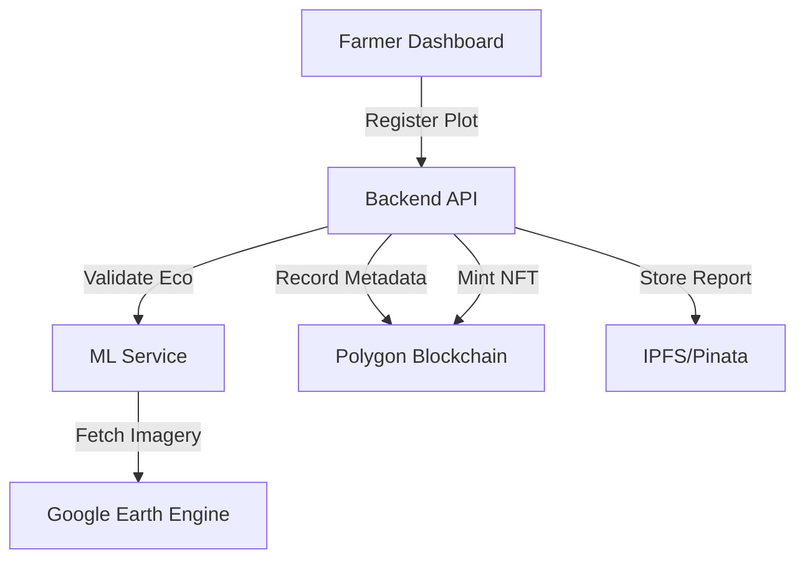

# Technical Report: Blockchain-Based Blue Carbon Registry and Automated MRV System

**Author**: Manish S P  
**Date**: April 29, 2026

## Abstract
This report details the implementation of a decentralized registry for Blue Carbon projects, integrating blockchain technology with automated Monitoring, Reporting, and Verification (MRV) using satellite imagery and machine learning. The system provides an end-to-end pipeline from geospatial plot registration to the minting of carbon credit NFTs, ensuring transparency, preventing double-counting, and automating the verification process through a "Virtual Oracle" powered by Google Earth Engine.

## 1. Introduction
Blue carbon ecosystems—mangroves, seagrasses, and saltmarshes—are among the most efficient carbon sinks on Earth. However, traditional carbon credit registries suffer from high verification costs, lack of transparency, and slow processing times. This project addresses these challenges by decentralizing the registry and automating the MRV pipeline.

## 2. System Architecture
The system employs a 4-tier architecture designed for robustness and data integrity.

### 2.1 Overview
*   **Frontend**: React/Vite dashboard for users to map plots and monitor credits.
*   **Backend**: Node.js/Express API orchestrating data flow between services.
*   **ML Service**: FastAPI service utilizing Google Earth Engine (GEE) for remote sensing.
*   **Blockchain**: Polygon (Amoy Testnet) smart contracts for immutable records.

### 2.2 Data Flow
The following diagram illustrates the interaction between components:

## 3. Methodology

### 3.1 Plot Registration and Mapping
Users define plot boundaries using an interactive Leaflet map. The system calculates the surface area in hectares using the Shoelace formula on projected coordinates.

### 3.2 Automated MRV Pipeline
The MRV process is architected as a "Virtual Oracle" that bridges off-chain satellite data with on-chain credit minting. It follows a cyclic workflow:
1.  **Geospatial Observation**: Mean NDVI (Normalized Difference Vegetation Index) values are retrieved via the Google Earth Engine API, utilizing Sentinel-2 Level-2A surface reflectance data.
2.  **Temporal Aggregation**: Four quarterly cycles are aggregated to form a robust annual baseline, mitigating seasonal fluctuations in vegetation.
3.  **Ecosystem Fingerprinting**: A Random Forest classifier validates the multispectral signature (NDVI, NDWI, EVI) against known profiles for mangroves, seagrass, and saltmarshes.

### 3.3 Carbon Credit Calculation & Verification
The system employs a density-based sequestration model:
$$Credits = Area (ha) \times BaseRate \times EcoDensity \times Time (yrs)$$

*   **Base Rate**: Fixed at 0.8 to provide a conservative buffer for potential environmental degradation.
*   **Density Factors**: Derived from IPCC-aligned sequestration averages (Mangrove: 1.35, Seagrass: 1.10, Saltmarsh: 0.95).
*   **On-Chain Guardrail**: The `BlueCarbonRegistry` contract re-calculates the expected credits during the minting transaction. If the submitted value deviates by more than **5%**, the transaction is reverted, ensuring the integrity of the minted NFTs.

## 4. Implementation Details

### 4.1 Smart Contracts
The `BlueCarbonRegistry` contract (Solidity 0.8.26) leverages OpenZeppelin's `ERC721URIStorage` for credit tokenization. Key functions include:
*   `registerPlot()`: Records the immutable plot boundaries, farmer address, and ecosystem type.
*   `mintCredit()`: Performs the tolerance-checked verification and mints the BRC (Blue Carbon Credit) NFT.
*   `previewExpectedCredits()`: An external view function allowing users to estimate their yield based on the contract's verified logic.

### 4.2 Machine Learning Components
The ML service uses:
*   **Random Forest Classifier**: For identifying ecosystem types from multi-spectral indices (NDVI, NDWI, EVI).
*   **Isolation Forest**: For detecting anomalies or potential fraudulent data submissions.

## 5. Performance Evaluation (Results)
The system's "Virtual Oracle" was evaluated using a dataset of 200 samples (50 per class) across four categories: Mangrove, Seagrass, Saltmarsh, and Other (non-blue carbon land).

### 5.1 Ecosystem Identification Accuracy
The Random Forest classifier achieved near-perfect separation due to the distinct multispectral and elevational signatures of the target ecosystems.

| Metric | Value |
| :--- | :--- |
| **Overall Accuracy** | 99.50% |
| **5-Fold CV Accuracy** | 99.50% ± 1.0% |
| **Macro F1-Score** | 0.9950 |
| **Mean ROC AUC** | 1.0000 |

#### Feature Importance:
Analysis of the Random Forest decision boundaries reveals that **NDWI** (0.41) and **NDVI** (0.32) are the primary drivers for ecosystem identification, with **Elevation** (0.19) playing a crucial role in distinguishing intertidal mangroves from inland vegetation.

### 5.2 Anomaly Detection Performance
The Isolation Forest was configured with a 5% contamination factor to simulate potential data anomalies or fraudulent claims. The model successfully identified 10/200 samples as anomalies, matching the expected distribution. This layer acts as a critical security feature, flagging projects for manual review if their multispectral profile deviates significantly from established ecological baselines.

## 6. Discussion & Conclusion
The implementation of a Blockchain-Based Blue Carbon Registry addresses the critical need for transparent and automated MRV. By combining the immutability of the Polygon blockchain with the high-resolution geospatial processing of Google Earth Engine, we have created a system that:
1.  **Reduces Verification Costs**: Automating quarterly monitoring eliminates the need for frequent on-site audits.
2.  **Ensures Data Integrity**: On-chain tolerance checks prevent the "gaming" of credit estimations.
3.  **Enhances Market Trust**: Permanent IPFS storage of MRV reports allows investors to audit the ecological basis of every minted credit.

Future enhancements will focus on integrating SAR (Synthetic Aperture Radar) data for better biomass estimation in cloud-prone regions and implementing a Decentralized Autonomous Organization (DAO) for community-led governance of the registry's parameters.
